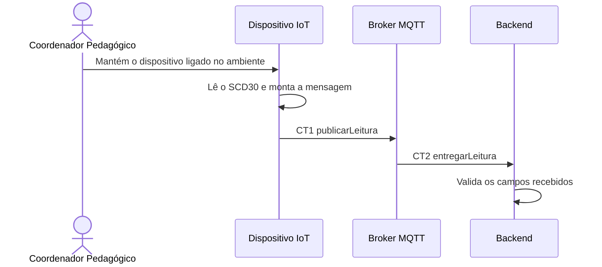

# Fluxo do E1 Leitura da qualidade do ar

**Feito quando da Entrega 1:** O sensor realiza a leitura de CO₂, temperatura e umidade, e os valores válidos são enviados ao sistema para processamento.

## Passos

1. O Coordenador Pedagógico mantém o Dispositivo IoT ligado no ambiente monitorado.
2. O Dispositivo IoT solicita ao sensor SCD30 as leituras de CO₂, temperatura e umidade por I2C.
3. O Dispositivo IoT verifica se os valores foram obtidos e monta a mensagem com a identificação do ambiente e o instante da medição.
4. O Dispositivo IoT publica a mensagem `publicarLeitura` no Broker MQTT utilizando o contrato CT1.
5. O Broker MQTT encaminha a mensagem `entregarLeitura` ao Backend utilizando o contrato CT2.
6. O Backend recebe os dados e valida os campos antes do processamento.

## Diagrama

**Contratos usados:** CT1 `publishReading`

