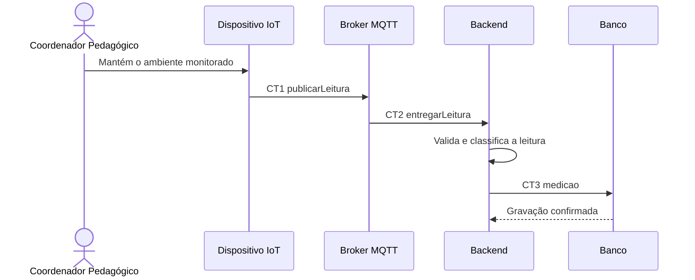

# Fluxo do E2 Registro das leituras

**Feito quando da Entrega 1:** Após uma leitura do sensor, o sistema armazena a data e os valores de CO₂, temperatura e umidade, que permanecem disponíveis para consulta posterior.

## Passos

1. O Coordenador Pedagógico mantém o ambiente sob monitoramento.
2. O Dispositivo IoT publica uma nova leitura válida no Broker MQTT por meio de CT1 `publicarLeitura`.
3. O Broker MQTT encaminha a leitura ao Backend por meio de CT2 `entregarLeitura`.
4. O Backend valida os campos e determina a situação do nível de CO₂.
5. O Backend grava a leitura na tabela `medicao` utilizando CT3.
6. O Banco confirma a gravação e a medição fica disponível para consultas posteriores.

## Diagrama

**Contratos usados:** CT1 `publishReading`, CT2 `sensor_reading`

