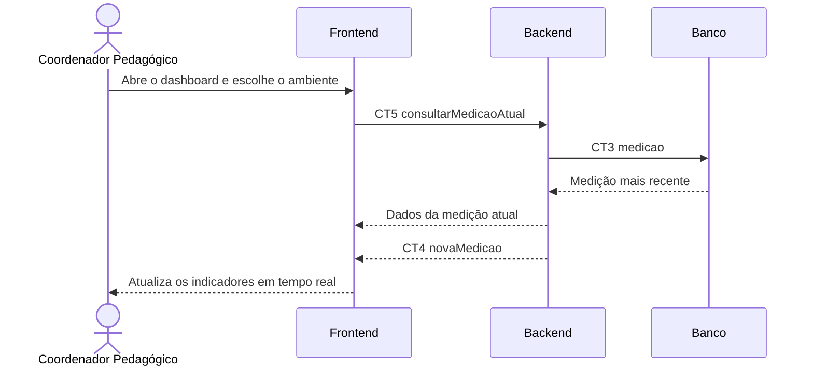

# Fluxo do E3 Visualização da qualidade do ar

**Feito quando da Entrega 1:** O usuário abre o dashboard e visualiza em tempo real os valores de CO₂, temperatura e umidade do ambiente monitorado, atualizados a cada nova leitura recebida.

## Passos

1. O Coordenador Pedagógico abre o dashboard do Frontend e escolhe o ambiente monitorado.
2. O Frontend chama CT5 `consultarMedicaoAtual` no Backend.
3. O Backend lê a medição mais recente na tabela `medicao` por meio de CT3.
4. O Backend devolve a medição atual ao Frontend.
5. O Frontend apresenta os valores de CO₂, temperatura e umidade.
6. O Frontend mantém o canal WebSocket aberto para receber CT4 `novaMedicao`.
7. Quando uma nova leitura é processada, o Backend envia CT4 e o Frontend atualiza a tela sem recarregar a página.

## Diagrama

**Contratos usados:** CT2 `sensor_reading`, CT5 `listReadings`

