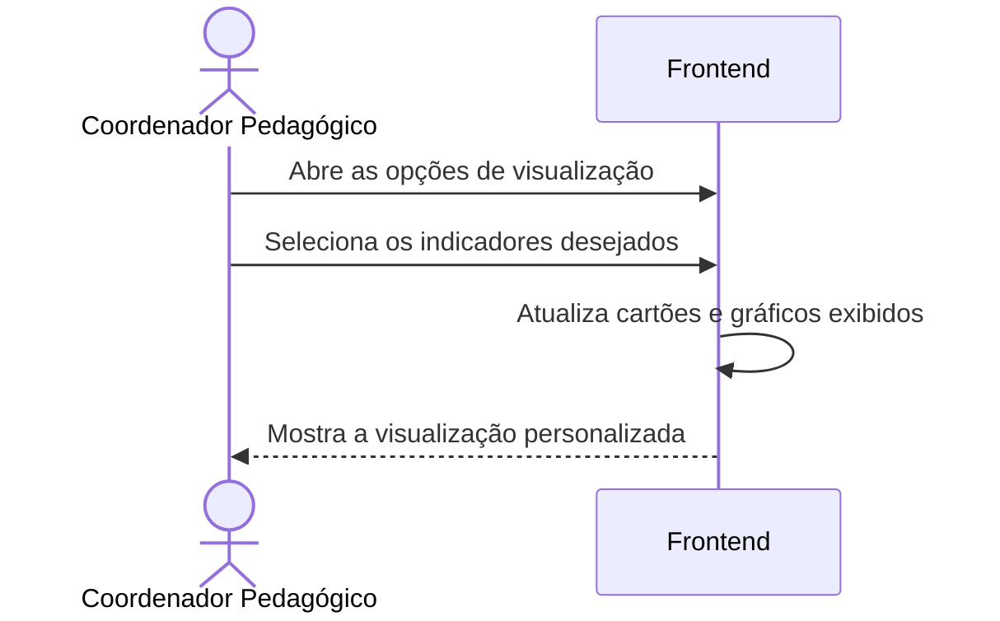

# Fluxo do E4 Customização da visualização

**Feito quando da Entrega 1:** O usuário pode escolher quais leituras serão demonstradas em sua tela, sem haver mudança nos registros.

## Passos

1. O Coordenador Pedagógico abre as opções de visualização no Frontend.
2. O Coordenador Pedagógico seleciona quais indicadores deseja visualizar entre CO₂, temperatura e umidade.
3. O Frontend altera somente a exibição dos cartões e gráficos escolhidos.
4. O Frontend preserva as medições originais sem enviar alteração ao Backend ou ao Banco.

## Diagrama

**Contratos usados:** não utiliza contratos entre módulos.

