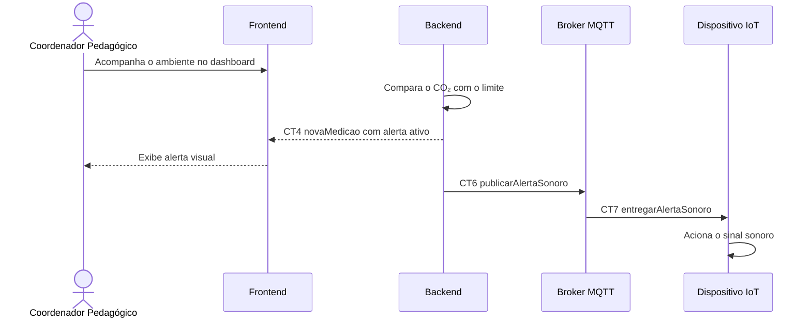

# Fluxo do E5 Mecanismos de alerta

**Feito quando da Entrega 1:** Quando os valores de CO₂ registrados ultrapassam o limite considerado saudável, o sistema exibe um alerta visual no dashboard e o dispositivo emite um sinal sonoro no local monitorado.

## Passos

1. O Coordenador Pedagógico mantém o dashboard aberto para acompanhar o ambiente.
2. O Backend recebe uma nova leitura e compara o valor de CO₂ com o limite configurado.
3. Ao identificar que o limite foi ultrapassado, o Backend envia CT4 `novaMedicao` ao Frontend com o nível de CO₂ e o alerta ativo.
4. O Frontend destaca o alerta visual para o Coordenador Pedagógico.
5. O Backend publica CT6 `publicarAlertaSonoro` no Broker MQTT.
6. O Broker MQTT encaminha CT7 `entregarAlertaSonoro` ao Dispositivo IoT.
7. O Dispositivo IoT aciona o sinal sonoro no ambiente monitorado.

## Diagrama

**Contratos usados:** CT4 `novaMedicao`, CT6 `publicarAlertaSonoro`, CT7 `entregarAlertaSonoro`.

