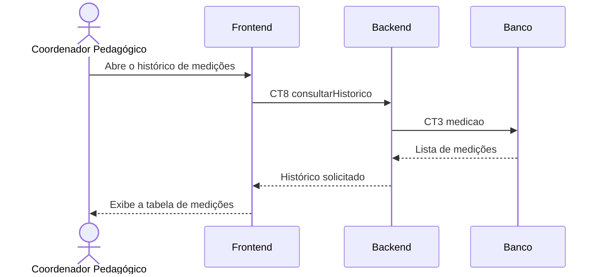

# Fluxo do E6 Consulta das medições

**Feito quando da Entrega 1:** O usuário pede para ver o histórico de medições, então o programa mostra uma tabela com as últimas medições feitas.

## Passos

1. O Coordenador Pedagógico abre a página de histórico no Frontend.
2. O Frontend envia CT8 `consultarHistorico` ao Backend, informando o ambiente e a quantidade de registros desejada.
3. O Backend consulta a tabela `medicao` por meio de CT3.
4. O Banco devolve as medições ordenadas da mais recente para a mais antiga.
5. O Backend devolve a lista ao Frontend.
6. O Frontend apresenta as últimas medições em uma tabela.

## Diagrama

**Contratos usados:** CT2 `sensor_reading` e CT5 `listReadings`.

