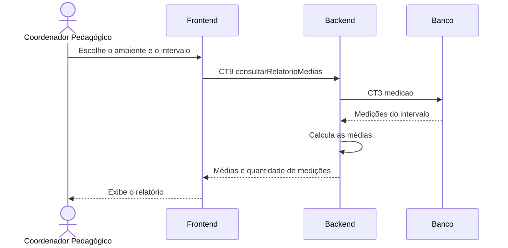

# Fluxo do E7 Relatórios de medições

**Feito quando da Entrega 1:** O usuário abre uma tela com a média das medições realizadas em um intervalo de tempo.

## Passos

1. O Coordenador Pedagógico abre a página de relatórios no Frontend.
2. O Coordenador Pedagógico escolhe o ambiente, a data inicial e a data final.
3. O Frontend envia CT9 `consultarRelatorioMedias` ao Backend.
4. O Backend consulta os registros correspondentes na tabela `medicao` por meio de CT3.
5. O Backend calcula as médias de CO₂, temperatura e umidade no intervalo solicitado.
6. O Backend devolve as médias e a quantidade de medições consideradas.
7. O Frontend apresenta o relatório ao Coordenador Pedagógico.

## Diagrama

**Contratos usados:** CT2 `sensor_reading` e CT6 `getAverage`.
