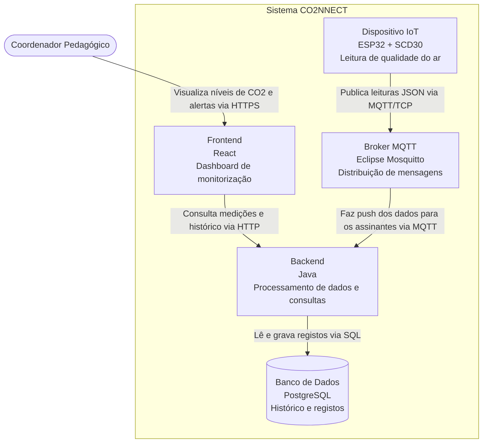

# Visão Geral

Esta página descreve os módulos que compõem o sistema CO₂NNECT e como eles se comunicam.

## Tabela de módulos

| Módulo | O que faz | Tecnologia | Repositório | Responsável |
| :--- | :--- | :--- | :--- | :--- |
| Frontend | Telas do dashboard para visualização de dados e alertas | Ainda a decidir | pi4-0102-g9-frontend | Giovana |
| Backend | Recebe leituras do Broker, valida e guarda no banco, além de responder às consultas do dashboard | Java | pi4-0102-g9-backend-1 | Gustavo Antunes |
| Dispositivo IoT | Realiza a leitura do sensor SCD30 via I2C e publica os dados na rede | C/C++ (ESP32) | pi4-0102-g9-backend-2 | Yuri |
| Banco | Guarda o histórico de clientes, ambientes e medições | PostgreSQL | junto do Backend | Julia |
| Broker MQTT | Intermedia a troca de mensagens entre o ESP32 e o servidor Java | Eclipse Mosquitto | junto do Backend | Gustavo Antunes, Yuri |

## Diagrama de contêineres



---

> [!WARNING]
> **NOTA INTERNA DE DESENVOLVIMENTO:** A seção a seguir contém um guia conceitual aprofundado para nivelamento técnico da equipe e **DEVE SER APAGADA ANTES DO ENVIO / ENTREGA FINAL** deste documento.

## Guia e Detalhamento Conceitual: Eclipse Mosquitto e Protocolo MQTT

Esta seção detalha o funcionamento do **Eclipse Mosquitto** e do protocolo **MQTT**, abordando desde os fundamentos de rede até as razões arquiteturais de sua escolha no sistema CO₂NNECT.

---

### 1. O que é o Protocolo MQTT e o que é o Eclipse Mosquitto?
Para compreender a arquitetura, é fundamental diferenciar o **protocolo** do **software**:
* **MQTT (*Message Queuing Telemetry Transport*):** É uma especificação/padrão de regras de comunicação de rede criada pela IBM no final da década de 1990. Foi originalmente projetada para monitorar oleodutos via satélite — um cenário onde as conexões eram extremamente lentas, caras e sujeitas a quedas constantes. Por isso, a premissa central do MQTT é ser **extremamente leve, confiável e econômico em uso de banda**.
* **Eclipse Mosquitto:** É a aplicação servidora (*Message Broker*) de código aberto que implementa as regras do protocolo MQTT (versões 5.0, 3.1.1 e 3.1). No nosso projeto, o Mosquitto roda dentro de um contêiner Docker e funciona como o centro de distribuição de todas as mensagens de telemetria.

---

### 2. O Modelo Publish/Subscribe (Pub/Sub) explicou em detalhes
No desenvolvimento web tradicional, a comunicação costuma seguir o modelo **Cliente-Servidor Síncrono (Request/Response via HTTP)**:
> No HTTP: O cliente (navegador/ESP32) abre uma conexão, faz uma requisição específica para o servidor ("me dê os dados" ou "salve isso"), fica bloqueado aguardando uma resposta e fecha a conexão. O servidor é passivo e nunca toma a iniciativa de enviar dados sem ser solicitado.

O MQTT quebra esse paradigma ao utilizar o padrão **Publicação/Assinatura (Pub/Sub)**, composto por três papéis:
1. **Publicador (*Publisher*):** É quem gera a informação. No CO₂NNECT, é o **ESP32**, que lê o sensor SCD30 e publica as métricas. O publicador não sabe (e não precisa saber) quem irá ler essas informações.
2. **Assinante (*Subscriber*):** É quem consome a informação. No nosso sistema, é o **Backend em Java**, que se conecta ao Mosquitto e declara interesse em receber as leituras.
3. **Corretor/Distribuidor (*Broker* - Eclipse Mosquitto):** É o intermediário central. Ele mantém a lista de quem quer receber o quê e faz o roteamento das mensagens recebidas para os respectivos interessados.

#### Por que esse modelo é vantajoso? Os Desacoplamentos:
* **Desacoplamento Espacial:** O ESP32 e o Backend em Java não conhecem os endereços IP ou portas um do outro. Ambos conhecem apenas o endereço do Mosquitto. Se o IP do servidor backend mudar ou se o serviço Java for reiniciado, o ESP32 continua funcionando perfeitamente sem sofrer nenhum erro de conexão direta.
* **Desacoplamento Temporal:** A comunicação não exige sincronismo estrito de execução. O ESP32 publica sua leitura no Broker em milissegundos e volta imediatamente para o seu ciclo de amostragem física, sem precisar ficar travado esperando o backend Java processar ou salvar no banco de dados.

---

### 3. Tópicos Hierárquicos e Curingas (*Wildcards*)
No MQTT, as mensagens não são enviadas para endereços de máquinas, mas sim para **Tópicos**. 
Um tópico é uma cadeia de texto que funciona de forma muito parecida com o caminho de pastas em um computador, utilizando barras (`/`) como delimitadores hierárquicos:

Exemplo prático de estrutura no CO₂NNECT:
```text
co2nect/bloco_a/sala_101/telemetria
co2nect/bloco_a/sala_102/telemetria
co2nect/bloco_b/laboratorio_01/telemetria
```

#### O poder dos Curingas (*Wildcards*) para a Ingestão:
Quando o Backend Java assina os tópicos no Mosquitto, ele não precisa cadastrar cada sala manualmente. O protocolo oferece dois caracteres curinga:
* **Curinga de Nível Único (`+`):** Substitui exatamente um nível na hierarquia.
  * Se o Java assinar: `co2nect/bloco_a/+/telemetria`
  * Ele receberá dados da `sala_101`, `sala_102`, etc., mas ignorará mensagens de outros blocos.
* **Curinga Multinível (`#`):** Substitui todos os níveis restantes a partir de onde for colocado (deve ser o último caractere).
  * Se o Java assinar: `co2nect/#`
  * O backend receberá automaticamente as leituras de **todas as salas de todos os blocos do campus**, através de uma única conexão mantida com o Broker. Isso viabiliza a escalabilidade elástica do sistema: novas salas e sensores podem ser instalados sem exigir qualquer alteração no código do backend.

---

### 4. Por que usar MQTT em vez de HTTP REST no ESP32?
A decisão de adotar MQTT com Mosquitto em vez de requisições HTTP comuns (POST) baseia-se em limitações de hardware do ESP32 e eficiência de rede:

| Característica | HTTP REST Tradicional | MQTT via Eclipse Mosquitto |
| :--- | :--- | :--- |
| **Conexão** | Efêmera: abre e fecha a conexão TCP a cada envio (*handshake* repetitivo). | Persistente: mantém um único canal TCP aberto e reutilizável. |
| **Tamanho do Cabeçalho (*Overhead*)** | Muito pesado: cabeçalhos de texto legível (User-Agent, Content-Type, Cookies) somam facilmente **500 a 1000 bytes** por pacote. | Extremamente leve: o cabeçalho fixo do pacote MQTT consome a partir de apenas **2 bytes**. |
| **Consumo do ESP32** | Alto: gasta mais ciclos de CPU para montar/parsear cabeçalhos e mais tempo de rádio Wi-Fi ligado (drenando mais energia). | Baixo: comunicação binária enxuta, liberando o microcontrolador rapidamente. |
| **Comunicação Bidirecional** | Difícil: o servidor não consegue enviar comandos ao ESP32 sem técnicas complexas de *polling*. | Nativa: o servidor pode publicar em um tópico (ex.: `co2nect/sala_101/comando`) e o ESP32 recebe instantaneamente. |

---

### 5. Recursos Avançados do Protocolo Úteis ao Projeto

#### A. Keep-Alive e Detecção de Queda
O ESP32 e o Mosquitto negociam um intervalo de batimento cardíaco (*Keep-Alive*, por exemplo, 60 segundos). Se o sensor não tiver dados para enviar durante esse tempo, ele dispara um minúsculo pacote de controle chamado `PINGREQ`, e o Mosquitto responde com `PINGRESP`. Isso mantém a rota do firewall ativa e permite ao Broker detectar quase de imediato se o dispositivo perdeu conexão ou alimentação elétrica.

#### B. Níveis de Qualidade de Serviço (QoS - *Quality of Service*)
O MQTT permite definir qual o nível de garantia de entrega desejado para cada mensagem:
* **QoS 0 — "No máximo uma vez" (*At most once*):** O publicador envia o pacote sem esperar confirmação ("dispare e esqueça"). Se houver oscilação de Wi-Fi, a mensagem pode ser perdida.
  * *Uso no CO₂NNECT:* Ideal para a telemetria rotineira do SCD30 enviada a cada poucos segundos. Se uma leitura se perder, a próxima chegará logo em seguida sem prejuízo ao histórico.
* **QoS 1 — "Ao menos uma vez" (*At least once*):** O remetente envia a mensagem e aguarda uma confirmação (`PUBACK`). Caso não receba a tempo, ele tenta reenviar. Garante a entrega, embora mensagens duplicadas possam ocorrer se o ACK se perder na rede.
  * *Uso no CO₂NNECT:* Recomendado para alertas críticos (ex.: concentração de CO₂ ultrapassando o limiar de emergência de 1500 ppm).
* **QoS 2 — "Exatamente uma vez" (*Exactly once*):** Realiza uma troca de 4 vias de confirmações (PUBREC, PUBREL, PUBCOMP). Garante entrega estritamente única, porém com maior latência e tráfego de rede.

#### C. Última Vontade e Testamento (*Last Will and Testament - LWT*)
Ao se conectar ao Mosquitto, o ESP32 pode registrar um "testamento": uma mensagem pré-agendada que o Broker só deve disparar caso a conexão do ESP32 caia de forma abrupta (sem um comando de desconexão limpo).
* *Exemplo prático:* O ESP32 define que, se ele cair, o Mosquitto deve publicar `"status": "offline"` no tópico `co2nect/sala_101/status`. O Backend Java recebe esse evento e pode atualizar o dashboard em tempo real informando que aquele sensor perdeu sinal.

---

### 6. Fluxo Integrado no Sistema CO₂NNECT (Ponta a Ponta)
Resumo de como os módulos trabalham juntos na cadeia de dados:
1. **Sensoriamento (Hardware):** O sensor SCD30 mede o ar a cada ciclo e transfere as variáveis (CO₂ em ppm, temperatura em °C e umidade relativa em %) ao ESP32 via barramento I2C.
2. **Serialização e Publicação:** O firmware em C/C++ do ESP32 monta um payload JSON enxuto (ex.: `{"co2": 820.4, "temp": 24.1, "umid": 55.0}`) e o publica via MQTT no tópico da sala correspondente.
3. **Distribuição em Tempo Real:** O **Eclipse Mosquitto** recebe a mensagem e a empurra (*push*) instantaneamente para todos os assinantes conectados naquele tópico.
4. **Ingestão e Regras de Negócio (Java):** A aplicação backend em Java consome a mensagem, valida os limites aceitáveis dos dados e executa a inserção persistente na base de dados relacional **PostgreSQL**.
5. **Apresentação (React):** O painel do dashboard consome a API do backend via HTTP/REST e renderiza gráficos temporais, indicadores numéricos e alertas visuais para os coordenadores pedagógicos.
